# KADESA — Controlled PostgreSQL Runtime Validation Preparation

**Tanggal Peninjauan:** 09 Oktober 2026  
**Auditor / Reviewer:** Senior SQL Reviewer & Backend Security Auditor  
**Status Alur Kerja:**
- Planning: **CLOSED** (PRD & Aturan Bisnis Terkunci)
- Frontend: **LULUS BERSYARAT** (Acceptance Audit Selesai)
- Backend Stage 1: **READY FOR RUNTIME VALIDATION** *(Belum Final-Approved)*
- Integration: **PENDING**
- Deployment: **PENDING**

---

## 1. Status Lingkungan Runtime: Ketersediaan & Batas Akses

Berdasarkan pemeriksaan langsung pada terminal sistem host pengembang (Windows PowerShell):

| Komponen Lingkungan Runtime | Status Ketersediaan | Bukti Pemeriksaan Terminal Aktual |
|---|:---:|---|
| **Docker Desktop / Docker Engine** | **UNAVAILABLE (NOT INSTALLED)** | `docker --version` melempar `CommandNotFoundException`. Container lokal tidak dapat dijalankan secara instan tanpa instalasi Docker. |
| **PostgreSQL Local Server (`psql`)** | **UNAVAILABLE (NOT INSTALLED)** | `psql --version` melempar `CommandNotFoundException`. Binari PostgreSQL client/server tidak terdaftar pada PATH Windows. |
| **Supabase CLI (`supabase`)** | **UNAVAILABLE (NOT INSTALLED)** | `supabase --version` melempar `CommandNotFoundException`. Local Supabase stack tidak dapat dipicu secara CLI. |
| **Supabase Cloud Project (Live)** | **AVAILABLE (NETWORK CONNECTED)** | Handshake HTTPS/TLS ke endpoint cloud Supabase `qjiwxtvhzeitjtznhkdc.supabase.co` sukses. Status database cloud saat ini: **FRESH / EMPTY (0 tabel KADESA)**. |
| **Supabase Isolated Staging Branch** | **PENDING USER SETUP** | Supabase Project Branching atau Staging Project terpisah belum dikonfigurasi. |

> [!IMPORTANT]
> **Prinsip Kejujuran Teknis:**  
> Seluruh skenario pengujian runtime database diklasifikasikan sebagai **NOT VERIFIED (RUNTIME ENVIRONMENT PENDING)**. Hasil pengujian unit offline (Vitest 65/65 passed), static typecheck (0 error), maupun analisis SQL statis **DILARANG KERAS** diklaim sebagai bukti pengujian runtime database.

---

## 2. Opsi Lingkungan Pengujian Terpisah & Prasyarat Setup

Untuk menjalankan pengujian runtime PostgreSQL tanpa risiko terhadap lingkungan produksi atau database cloud definitif, berikut 3 opsi arsitektur terisolasi:

```mermaid
flowchart TD
    subgraph Opsi 1: Docker Lokal Terisolasi
        D1[Instal Docker Desktop] --> D2[Jalankan postgres:15-alpine]
        D2 --> D3[Mount migrations 001-006]
        D3 --> D4[Eksekusi runtime_validation_suite.sql]
    end

    subgraph Opsi 2: Supabase Staging Terpisah
        S1[Buat Project Baru / Branch Staging] --> S2[Apply Migrations 001-006 via SQL Editor]
        S2 --> S3[Eksekusi Test Suite Berbasis Transaksi ROLLBACK]
    end

    subgraph Opsi 3: Ephemeral CI Database
        C1[GitHub Actions / Local Podman] --> C2[Spin up Ephemeral PostgreSQL Service]
        C2 --> C3[Automated pg_prove / psql Runner]
    end
```



### Opsi A (Direkomendasikan): Lingkungan Kontainer Docker Lokal
* **Karakteristik:** 100% terisolasi di mesin lokal, tidak menggunakan jaringan internet, tidak menimbulkan biaya, dan dapat di-destroy dalam hitungan detik.
* **Prasyarat & Langkah Setup:**
  1. Pasang Docker Desktop untuk Windows.
  2. Jalankan kontainer PostgreSQL pengujian sementara:
     ```powershell
     docker run --name kadesa-pg-test -e POSTGRES_PASSWORD=kadesa_test_pw -e POSTGRES_DB=kadesa_test -p 54322:5432 -d postgres:15-alpine
     ```
  3. Terapkan migrasi `001` s.d. `006` secara berurutan:
     ```powershell
     Get-ChildItem -Path supabase/migrations/*.sql | Sort-Object Name | ForEach-Object {
         docker exec -i kadesa-pg-test psql -U postgres -d kadesa_test < $_.FullName
     }
     ```
  4. Jalankan artefak uji runtime:
     ```powershell
     docker exec -i kadesa-pg-test psql -U postgres -d kadesa_test < supabase/tests/runtime_validation_suite.sql
     ```
  5. Hancurkan kontainer setelah selesai (Zero Residue):
     ```powershell
     docker stop kadesa-pg-test; docker rm kadesa-pg-test
     ```

### Opsi B: Project Supabase Staging Terpisah (Cloud Sandbox)
* **Karakteristik:** Menggunakan engine PostgreSQL resmi Supabase (termasuk Auth schema dan PostgREST), namun terisolasi pada Project Ref berbeda dari database definitif.
* **Prasyarat & Langkah Setup:**
  1. Siapkan 1 Supabase Project gratis terpisah khusus staging/testing.
  2. Buka Supabase Dashboard > SQL Editor pada project staging tersebut.
  3. Eksekusi skrip migrasi `001` s.d. `006` secara berurutan.
  4. Jalankan skrip [`supabase/tests/runtime_validation_suite.sql`](file:///d:/DAWANK/APLIKASI_TEST/KADESA/supabase/tests/runtime_validation_suite.sql).

---

## 3. Matriks Pengujian Komprehensif (Test Matrix)

| Kategori Pengujian | ID Uji | Target & Kondisi Pengujian | Kriteria Lulus (Pass Criteria) | Status Saat Ini |
|---|---|---|---|:---:|
| **1. Pipeline Migrasi** | **MIG-01** | Eksekusi fresh install berurutan (001 $\rightarrow$ 002 $\rightarrow$ 003 $\rightarrow$ 004 $\rightarrow$ 005 $\rightarrow$ 006) | Seluruh DDL sukses tanpa error; 14 tabel, 8 enum, 15 indeks terpasang. | **NOT VERIFIED** |
| | **MIG-02** | Eksekusi ulang skrip secara berurutan (Uji Idempotensi) | Eksekusi kedua tidak menghasilkan error `duplicate_object` atau `already exists`. | **NOT VERIFIED** |
| **2. Geofence Sisi Server** | **GEO-01** | Presensi REGULAR saat `OFFICE_COORDINATES_CONFIRMED = 'false'` | Ditolak mutlak (`RAISE EXCEPTION`), kode SQLSTATE `P0001`. | **NOT VERIFIED** |
| | **GEO-02** | Presensi REGULAR dengan koordinat di dalam radius $(\le 100\text{m})$ setelah konfirmasi | Diterima; `check_in_distance_meters` diisi otomatis dari hasil fungsi Haversine DB. | **NOT VERIFIED** |
| | **GEO-03** | Presensi REGULAR dengan koordinat di luar radius $(> 100\text{m})$ | Ditolak mutlak (`RAISE EXCEPTION`); transaksi dibatalkan. | **NOT VERIFIED** |
| | **GEO-04** | Presensi REGULAR dengan koordinat parsial (latitude ada, longitude NULL) | Ditolak mutlak (`RAISE EXCEPTION: Koordinat Check-In tidak lengkap`). | **NOT VERIFIED** |
| | **GEO-05** | Presensi REGULAR dengan koordinat di luar batas bumi ($lat > 90$ atau $lng > 180$) | Ditolak mutlak (`RAISE EXCEPTION: Nilai latitude/longitude tidak valid`). | **NOT VERIFIED** |
| **3. Koreksi Presensi** | **COR-01** | Pembuatan pengajuan koreksi baru dengan status langsung `APPROVED` | Ditolak mutlak; status baru wajib `PENDING`. | **NOT VERIFIED** |
| | **COR-02** | Pemohon menyetujui koreksinya sendiri (Self-Approval) | Ditolak mutlak (`RAISE EXCEPTION: Konflik kepentingan`). | **NOT VERIFIED** |
| | **COR-03** | Penerapan koreksi `APPROVED` ke `attendance_records` secara sah | Nilai target berubah atomik; baris koreksi otomatis terisi `applied_at` & `applied_by`. | **NOT VERIFIED** |
| | **COR-04** | Upaya Replay: Menggunakan koreksi yang sudah memiliki `applied_at` | Ditolak mutlak (`RAISE EXCEPTION: Dokumen koreksi belum digunakan tidak ditemukan`). | **NOT VERIFIED** |
| | **COR-05** | Klien memodifikasi `applied_at` atau nilai usulan secara langsung via PostgREST | Ditolak mutlak oleh trigger `enforce_attendance_correction_lifecycle`. | **NOT VERIFIED** |
| **4. Alur Dinas Luar (DL)** | **DLA-01** | Pembuatan pengajuan tugas baru dengan status `APPROVED` atau `RATIFIED` | Ditolak mutlak; wajib `PENDING`. Kolom `verified_*`, `approved_*`, `ratified_*` dipaksa NULL. | **NOT VERIFIED** |
| | **DLA-02** | Pemohon atau subjek memverifikasi / menyetujui tugasnya sendiri | Ditolak mutlak (`RAISE EXCEPTION: Konflik kepentingan`). | **NOT VERIFIED** |
| | **DLA-03** | Ratifikasi DL oleh role selain Kepala Desa / Super Admin | Ditolak mutlak (`RAISE EXCEPTION: Hanya Kepala Desa yang berwenang meratifikasi`). | **NOT VERIFIED** |
| | **DLA-04** | Penolakan tanpa `rejection_reason` atau pembatalan tanpa `cancellation_reason` | Ditolak mutlak (`RAISE EXCEPTION: Alasan wajib diisi`). | **NOT VERIFIED** |
| | **DLA-05** | Upaya modifikasi parameter atau status setelah mencapai `RATIFIED` | Ditolak mutlak; baris `RATIFIED` bersifat immutable dan terminal. | **NOT VERIFIED** |
| **5. RLS & RBAC** | **RLS-01** | Pengguna membaca baris presensi aparatur lain tanpa wewenang | PostgREST mengembalikan 0 baris (Row filtering RLS bekerja). | **NOT VERIFIED** |
| | **RLS-02** | Operator Desa mencoba menaikkan role akun miliknya sendiri | Ditolak mutlak oleh trigger `trg_protect_auth_user_id`. | **NOT VERIFIED** |
| | **RLS-03** | Operator Desa mencoba mengedit atau menonaktifkan akun Super Admin | Ditolak mutlak (`RAISE EXCEPTION: Akun Super Admin dilindungi sistem`). | **NOT VERIFIED** |
| **6. Audit Log WORM** | **AUD-01** | Upaya UPDATE atau DELETE langsung pada tabel `audit_logs` | Ditolak mutlak oleh trigger `trg_deny_audit_logs_mutation`. | **NOT VERIFIED** |
| | **AUD-02** | Upaya INSERT langsung pada `audit_logs` dari klien PostgREST | Ditolak mutlak oleh hak akses PostgreSQL (`42501 permission denied`). | **NOT VERIFIED** |
| **7. Konkurensi & Locking**| **CON-01** | Dua transaksi konkuren mencoba mengonsumsi koreksi presensi yang sama | Transaksi 1 berhasil; Transaksi 2 menunggu row lock `FOR UPDATE`, lalu ditolak karena `applied_at` telah terisi. | **NOT VERIFIED** |
| | **CON-02** | Analisis potensi kebuntuan (Deadlock) pada beban multi-koneksi | Terverifikasi urutan penguncian searah; tidak ada deadlock teramati pada uji coba. | **NOT VERIFIED** |

---

## 4. Pengujian Skenario Negatif (Negative Test Harness)

Seluruh pengujian negatif telah dienkapsulasi ke dalam skrip runnable [`supabase/tests/runtime_validation_suite.sql`](file:///d:/DAWANK/APLIKASI_TEST/KADESA/supabase/tests/runtime_validation_suite.sql).

### Contoh Skenario & Bukti Eksepsi yang Diharapkan:
1. **Neg-01: Bypass Anonim PostgREST (`auth.uid() IS NULL`):**
   - **Tindakan:** Mengirim query DML tanpa JWT token autentikasi.
   - **Ekspektasi SQL:** Error `Aksi ditolak: sesi autentikasi pengguna tidak valid atau anonim.`
2. **Neg-02: Self-Approval Koreksi Presensi:**
   - **Tindakan:** UPDATE `attendance_corrections` set `state = 'APPROVED'` oleh user pengaju.
   - **Ekspektasi SQL:** Error `Konflik kepentingan: Pemohon atau aparatur terkait dilarang menyetujui koreksi presensinya sendiri.`
3. **Neg-03: Replay Konsumsi Koreksi:**
   - **Tindakan:** UPDATE `attendance_records` kedua kali menggunakan koreksi ber-`applied_at` tidak NULL.
   - **Ekspektasi SQL:** Error `Koreksi presensi ditolak: Tidak ditemukan dokumen koreksi berstatus APPROVED yang sah, belum digunakan, dan sesuai persis...`
4. **Neg-04: Modifikasi Audit Log WORM:**
   - **Tindakan:** DELETE FROM `audit_logs` WHERE id = '...'.
   - **Ekspektasi SQL:** Error `Audit logs bersifat WORM (Write Once, Read Many) dan tidak dapat diubah atau dihapus.`
5. **Neg-05: Presensi Kantor Saat Koordinat Belum Dikonfirmasi:**
   - **Tindakan:** INSERT `attendance_records` type REGULAR saat `OFFICE_COORDINATES_CONFIRMED = 'false'`.
   - **Ekspektasi SQL:** Error `Presensi kantor ditolak: Koordinat resmi kantor desa belum dikonfirmasi oleh Administrator. Geofence operasional belum aktif.`

---

## 5. Bukti yang Wajib Dikumpulkan Saat Validasi Runtime

Ketika lingkungan pengujian terpisah telah siap dan dijalankan, auditor wajib mengumpulkan bukti-bukti berikut:
1. **Log Eksekusi Migrasi 001–006:** Catatan terminal lengkap yang memuat `CREATE TABLE`, `CREATE FUNCTION`, `CREATE TRIGGER`, dan `CREATE POLICY` tanpa syntax warning atau dependency failure.
2. **PostgreSQL Error Codes (SQLSTATE):**
   - Bukti kode `P0001` (`raise_exception`) untuk seluruh aturan bisnis KADESA yang sengaja dilanggar pada uji negatif.
   - Bukti kode `23505` (`unique_violation`) untuk duplikasi `uq_user_attendance_date`.
   - Bukti kode `42501` (`insufficient_privilege`) untuk akses langsung ke `audit_logs` atau RPC `calculate_haversine_distance_meters`.
3. **Output Skrip Pengujian:** Tangkapan layar / log stdout dari eksekusi [`supabase/tests/runtime_validation_suite.sql`](file:///d:/DAWANK/APLIKASI_TEST/KADESA/supabase/tests/runtime_validation_suite.sql).
4. **Schema Diff Output (`pg_dump -s`):** Bukti biner bahwa database fresh-install dan upgrade menghasilkan definisi skema yang identik (Zero Schema Drift).

---

## 6. Prosedur Rollback Lingkungan Pengujian

Untuk memastikan lingkungan pengujian tidak meninggalkan residu dan dapat direset ke status awal secara instan:

### Prosedur Rollback 1: Di Dalam Skenario Pengujian (Transactional)
Seluruh blok uji pada [`runtime_validation_suite.sql`](file:///d:/DAWANK/APLIKASI_TEST/KADESA/supabase/tests/runtime_validation_suite.sql) menggunakan pembungkus transaksi:
```sql
BEGIN;
-- Eksekusi skenario uji DML
ROLLBACK; -- Membatalkan seluruh perubahan secara instan
```

### Prosedur Rollback 2: Reset Total Database Uji (Full Teardown)
Jika pengujian dilakukan di PostgreSQL / Supabase Staging dan memerlukan reset skema bersih:
```sql
-- Teardown Skema KADESA di Lingkungan Uji
DROP SCHEMA IF EXISTS public CASCADE;
CREATE SCHEMA public;
GRANT ALL ON SCHEMA public TO postgres;
GRANT ALL ON SCHEMA public TO public;
```

---

## 7. Analisis Risiko yang Masih Terbuka (Open Risks)

1. **Deadlock Multi-Koneksi Tinggi:**
   Meskipun penguncian baris dirancang satu arah (`attendance_records` $\rightarrow$ `attendance_corrections`), risiko deadlock dalam kondisi beban ratusan transaksi simultan per detik tidak dapat dibuktikan 0% tanpa uji beban konkurensi (load test tool seperti `k6` atau `pgbench`).
2. **Latensi Jaringan Kalkulasi Server-Side:**
   Kalkulasi jarak Haversine di dalam trigger database menambahkan beban mikro-komputasi CPU database pada setiap check-in/check-out. Pada server berkapasitas rendah, indeks dan vacuuming berkala pada tabel `attendance_records` wajib dipelihara.
3. **Ketergantungan Koordinat Definitif Lapangan:**
   Geofence operasional tidak boleh diaktifkan sebelum Pemerintah Desa Sukamaju menyerahkan titik koordinat resmi balai desa yang telah disurvei lapangan.

---

## 8. Status Gerbang Rekomendasi (Gate Status)

### **STATUS: READY FOR RUNTIME VALIDATION (CONTROLLED PREPARATION COMPLETED)**

* **Analisis SQL Sumber Statis:** **PASS** (Migrasi 001–006 valid, regresi geofence teratasi, state machine DL & koreksi terkunci).
* **Pengujian Aplikasi Offline:** **PASS** (65/65 tests pass, 0 error typecheck, build produksi bersih).
* **Persiapan Artefak Uji Runtime:** **COMPLETED** (Tersedia rencana pengujian dan skrip otomatis [`runtime_validation_suite.sql`](file:///d:/DAWANK/APLIKASI_TEST/KADESA/supabase/tests/runtime_validation_suite.sql)).
* **Eksekusi Runtime Database:** **NOT VERIFIED** (Menunggu persetujuan pengguna dan penyediaan lingkungan uji terisolasi).
* **Backend Stage 1 Final Gate:** **PENDING HUMAN REVIEW & RUNTIME EXECUTION**.
