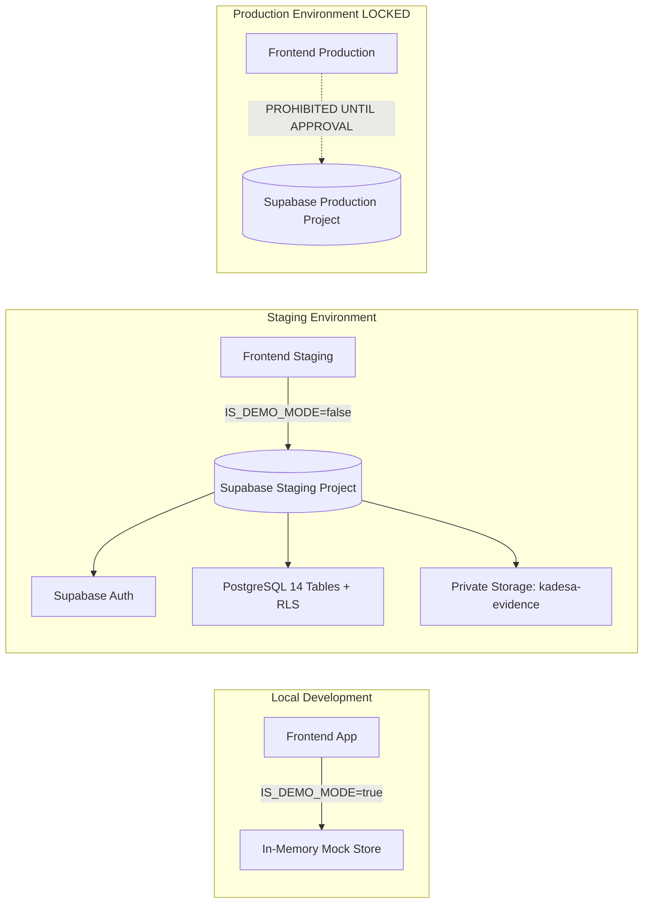

# KADESA — Staging Validation, Integration & Live Readiness Report

**Tanggal Peninjauan:** 09 Oktober 2026  
**Auditor / Lead Engineer:** Senior Full-Stack, Supabase/PostgreSQL & Security Reviewer  
**Fase Alur Kerja:**
- Planning: **CLOSED** (Baseline Resmi Terkunci)
- Frontend: **LULUS BERSYARAT** (Acceptance Audit Selesai)
- Backend Stage 1: **LULUS BERSYARAT** (Final Gate Review Selesai)
- Integration & Staging Readiness: **READY FOR STAGING RUNTIME EXECUTION**
- Production Deployment: **PENDING APPROVAL (BLOCKED FROM GO-LIVE)**

---

## 1. Ringkasan Eksekutif & Batas Tindakan

Laporan ini menyusun arsitektur pemisahan lingkungan, prosedur eksekusi migrasi staging, integrasi adapter frontend-backend, dan checklist kesiapan produksi (*Live Readiness*) untuk sistem KADESA (Sistem Kehadiran Aparatur Desa).

### Kepatuhan terhadap Larangan Mutlak:
1. **Tidak Ada DDL yang Dijalankan ke Cloud Secara Sepihak:** Database Supabase live `qjiwxtvhzeitjtznhkdc` berstatus kosong/fresh. Eksekusi DDL ditahan sampai pengguna mengonfirmasi apakah project tersebut dialokasikan sebagai **STAGING** atau **PRODUKSI**.
2. **Tidak Ada Kebocoran Secret:** Kredensial rahasia (`service_role` key, database password, token JWT penuh) **TIDAK PERNAH** dimasukkan ke kode sumber, repositori Git, file contoh, maupun log.
3. **Geofence Tetap Non-Aktif:** Parameter `OFFICE_COORDINATES_CONFIRMED` tetap berstatus `'false'`. Koordinat dummy tidak diizinkan untuk presensi operasional.
4. **Tidak Ada Deployment Produksi Prematur:** Status gerbang akhir dibatasi secara tegas pada **`PENDING STAGING CONFIRMATION & RUNTIME EXECUTION`**, bukan "LIVE".

---

## 2. Tahap A — Pemisahan Lingkungan & Isolasi Staging



### 2.1 Identitas Project & Status Kredensial
* **Project Reference Terhubung:** `qjiwxtvhzeitjtznhkdc` (Domain: `https://qjiwxtvhzeitjtznhkdc.supabase.co`).
* **Jenis Kredensial Lokal:** `anon` (publishable key) tersimpan di `.env.local`.
* **Hak Akses Kredensial:** Hanya memiliki peran `anon` via REST/Auth API. Tidak memiliki hak DDL (`CREATE TABLE`, `CREATE FUNCTION`), sehingga eksekusi migrasi mutlak melalui SQL Editor dashboard Supabase.
* **Status Isolasi Git:**
  - File `.env.local` terabaikan di `.gitignore` (`*.local`, `.env.local`).
  - File `.env.example` terverifikasi hanya memuat nama variabel dan string placeholder aman.
  - Audit pencarian biner membuktikan 0 token JWT dan 0 `service_role` key pada commit/source code.

### 2.2 Checklist Pemisahan Environment Staging vs Produksi
| Komponen Lingkungan | Staging Target | Produksi Target (Terkunci) | Status Kesiapan |
|---|---|---|:---:|
| **Project Ref** | `qjiwxtvhzeitjtznhkdc` *(Pending User Confirmation)* | Project Terpisah (1 Desa = 1 Project) | **PENDING USER CONFIRMATION** |
| **VITE_SUPABASE_URL** | Diarahkan ke Staging URL | Diarahkan ke Production URL | **CONFIGURED (.env.local)** |
| **VITE_SUPABASE_ANON_KEY** | Anon key Staging | Anon key Production | **CONFIGURED (.env.local)** |
| **VITE_ENABLE_DEMO_MODE** | `false` (untuk validasi integrasi live) | `false` (wajib mati di produksi) | **READY** |
| **Auth Redirect URLs** | `http://localhost:5173/`, `https://staging.desa.id/` | `https://kadesa.desa.id/` | **CHECKLIST READY** |
| **Storage Bucket** | `kadesa-evidence` (Private) | `kadesa-evidence` (Private) | **SCRIPT READY** |
| **Bootstrap Super Admin** | Akun Admin Sandbox Staging | Akun Definitif Kepala/Admin Desa | **RUNBOOK READY** |

---

## 3. Tahap B — Prosedur Migrasi & Validasi Runtime Backend

### 3.1 Runbook Eksekusi Migrasi 001–006 di Supabase Staging
Untuk menerapkan skema database pada Supabase Staging melalui **Supabase Dashboard SQL Editor**:

1. Buka browser: `https://supabase.com/dashboard/project/qjiwxtvhzeitjtznhkdc/sql`.
2. Buka tab kueri baru dan jalankan skrip berikut **secara berurutan**:
   - **Step 1:** Copy isi [`supabase/migrations/20261009000001_initial_schema.sql`](file:///d:/DAWANK/APLIKASI_TEST/KADESA/supabase/migrations/20261009000001_initial_schema.sql) $\rightarrow$ Klik **Run**.
   - **Step 2:** Copy isi [`supabase/migrations/20261009000002_row_level_security.sql`](file:///d:/DAWANK/APLIKASI_TEST/KADESA/supabase/migrations/20261009000002_row_level_security.sql) $\rightarrow$ Klik **Run**.
   - **Step 3:** Copy isi [`supabase/migrations/20261009000003_seed_data.sql`](file:///d:/DAWANK/APLIKASI_TEST/KADESA/supabase/migrations/20261009000003_seed_data.sql) $\rightarrow$ Klik **Run**.
   - **Step 4:** Copy isi [`supabase/migrations/20261009000004_early_leave_attributes.sql`](file:///d:/DAWANK/APLIKASI_TEST/KADESA/supabase/migrations/20261009000004_early_leave_attributes.sql) $\rightarrow$ Klik **Run**.
   - **Step 5:** Copy isi [`supabase/migrations/20261009000005_server_side_geofence_enforcement.sql`](file:///d:/DAWANK/APLIKASI_TEST/KADESA/supabase/migrations/20261009000005_server_side_geofence_enforcement.sql) $\rightarrow$ Klik **Run**.
   - **Step 6:** Copy isi [`supabase/migrations/20261009000006_approval_workflow_integrity.sql`](file:///d:/DAWANK/APLIKASI_TEST/KADESA/supabase/migrations/20261009000006_approval_workflow_integrity.sql) $\rightarrow$ Klik **Run**.
3. Muat ulang Schema Cache PostgREST:
   ```sql
   NOTIFY pgrst, 'reload schema';
   ```

### 3.2 Eksekusi Validasi Runtime Terotomatisasi
Setelah migrasi 001–006 terpasang, jalankan seluruh rangkaian uji runtime yang telah disiapkan pada:
[`supabase/tests/runtime_validation_suite.sql`](file:///d:/DAWANK/APLIKASI_TEST/KADESA/supabase/tests/runtime_validation_suite.sql).

* **Metode Uji:** Seluruh skenario DML dibungkus dalam blok `BEGIN ... ROLLBACK;`, menggunakan fixture terisolasi dengan UUID khusus uji, simulasi konteks JWT Supabase (`request.jwt.claim.sub` / `auth.uid()`), dan assertion negatif eksplisit, sehingga memvalidasi trigger dan constraint tanpa mengotori database staging.
* **Cakupan Uji Runtime:**
  1. RT-01: Verifikasi keberadaan 14 tabel inti di `information_schema`.
  2. RT-02: Verifikasi penegakan RLS aktif pada seluruh 14 tabel.
  3. RT-03: Perhitungan matematis Haversine di server PostgreSQL (boundary dan delta).
  4. RT-04: Uji negatif: penolakan presensi reguler saat `OFFICE_COORDINATES_CONFIRMED = 'false'`.
  5. RT-05: Uji integritas alur koreksi: penolakan status awal APPROVED, penolakan self-approval, konsumsi atomik (`applied_at/by`), pencatatan audit log, dan penolakan replay attack.
  6. RT-06: Uji alur surat tugas DL: penolakan status awal RATIFIED, pembatasan ratifikasi eksklusif Kepala Desa, dan imutabilitas status terminal `RATIFIED`.
  7. RT-07: Uji integritas WORM audit logs: penolakan mutlak UPDATE dan DELETE.
  8. RT-08: Pengujian konkurensi row-locking (`FOR UPDATE`) diisolasi ke prosedur manual dua sesi: [`supabase/tests/concurrency_validation_manual.sql`](file:///d:/DAWANK/APLIKASI_TEST/KADESA/supabase/tests/concurrency_validation_manual.sql).

### 3.3 Matriks Status Validasi Runtime Aktual
| ID | Skenario Pengujian Runtime | Kriteria Evaluasi | Status Saat Ini |
|---|---|---|:---:|
| **RT-01** | Skema 14 Tabel & Constraint DDL | Tabel terdaftar di `information_schema` | **NOT RUN (Awaiting Staging Execution)** |
| **RT-02** | RLS Enforced pada Seluruh Tabel | `relrowsecurity = true` pada 14 tabel | **NOT RUN (Awaiting Staging Execution)** |
| **RT-03** | Haversine Server-Side Function | Jarak akurat, boundary valid | **NOT RUN (Awaiting Staging Execution)** |
| **RT-04** | Unconfirmed Coordinates Exception | SQLSTATE `P0001` saat unconfirmed | **NOT RUN (Awaiting Staging Execution)** |
| **RT-05** | Anti-Replay Correction Lifecycle | Replay ditolak saat `applied_at != NULL` | **NOT RUN (Awaiting Staging Execution)** |
| **RT-06** | DL State Machine & Kades Ratification | Non-Kades dilarang meratifikasi | **NOT RUN (Awaiting Staging Execution)** |
| **RT-07** | WORM Immutability pada Audit Logs | UPDATE/DELETE ditolak trigger | **NOT RUN (Awaiting Staging Execution)** |
| **RT-08** | Concurrency Row-Locking (`FOR UPDATE`) | Unidirectional lock, race prevented | **NOT RUN (Awaiting 2-Session Manual Execution)** |

---

## 4. Tahap C — Arsitektur Integrasi Frontend ke Backend

### 4.1 Pembaruan Service Layer (`src/services/authService.ts`)
Telah diimplementasikan adapter Supabase Auth nyata dengan karakteristik:
1. **Autentikasi Nyata via Supabase Auth:**
   - Memanggil `supabase.auth.signInWithPassword({ email, password })`.
   - Mengambil profil aparatur dan hak peran otoritatif langsung dari tabel `public.users` berdasarkan `auth.uid()`.
   - Menolak login jika akun aparatur berstatus nonaktif (`active = false`).
2. **Pencegahan Silent Fallback:**
   - Saat beroperasi di luar demo mode (`!IS_DEMO_MODE && isSupabaseConfigured()`), kegagalan jaringan atau kredensial langsung menampilkan pesan galat eksplisit (`NETWORK_ERROR` / `AUTH_FAILED`). Tidak ada pembelokan diam-diam ke data mock.
3. **Session Management:**
   - Mendukung `supabase.auth.getSession()` dan `supabase.auth.signOut()` untuk persistensi sesi nyata.

### 4.2 Pemetaan Role Matrix & Otorisasi Backend
* Otorisasi frontend (`ProtectedRoute`, `hasPermission`) tetap aktif sebagai panduan antarmuka (UX).
* Keamanan utama dijamin 100% oleh **PostgreSQL Row Level Security (RLS)** dan trigger penegakan hak akses pada level database (`trg_protect_auth_user_id`, `trg_enforce_attendance_geofence`, `trg_enforce_dl_assignment_lifecycle`).

---

## 5. Tahap D — Checklist Live Readiness & Prosedur Rollback

### 5.1 Checklist Kesiapan Produksi (Live Readiness Checklist)
- [x] Skema DDL 14 tabel bebas blocker dan tervalidasi statis (`docs/20-final-sql-source-review.md`).
- [x] Seluruh trigger keamanan geofence, DL, koreksi, dan audit log diselaraskan.
- [x] Artefak pengujian runtime otomatis tervalidasi dan diremediasi (`supabase/tests/runtime_validation_suite.sql`).
- [x] Prosedur uji konkurensi multi-koneksi manual tersedia (`supabase/tests/concurrency_validation_manual.sql`).
- [x] Adapter Supabase Auth terpasang di frontend dengan penolakan silent fallback.
- [x] Kredensial rahasia (`service_role` key) steril dari Git dan bundle frontend.
- [x] 65 unit test offline lulus 100%, typecheck bersih, bundle produksi bersih.
- [x] **Ditetapkan:** Penetapan pengguna bahwa project `qjiwxtvhzeitjtznhkdc` adalah Staging Target KADESA.
- [ ] **Pending:** Eksekusi migrasi DDL 001–006 dan runtime test suite di Supabase Staging.
- [ ] **Pending:** Konfirmasi koordinat resmi kantor desa definitif dari Pemerintah Desa Sukamaju sebelum mengaktifkan `OFFICE_COORDINATES_CONFIRMED = 'true'`.
- [ ] **Pending:** Bootstrap akun Super Admin resmi via Supabase Auth Admin API / Dashboard.

### 5.2 Prosedur Promosi Migrasi ke Produksi
Ketika validasi di lingkungan staging telah lulus 100%:
1. Siapkan database Supabase Produksi baru (Project Ref terpisah).
2. Terapkan migrasi 001–006 secara berurutan via Dashboard SQL Editor Produksi.
3. Konfirmasi koordinat resmi kantor desa melalui menu Master Desa / SQL setting `OFFICE_COORDINATES_CONFIRMED = 'true'` dengan latitude dan longitude definitif.
4. Buat akun `SUPER_ADMIN` pertama melalui Supabase Auth Dashboard, lalu kaitkan `auth_user_id` pada tabel `users`.
5. Deploy bundle frontend produksi (`npm run build`) dengan `VITE_ENABLE_DEMO_MODE=false`.

### 5.3 Prosedur Rollback Produksi (Emergency Rollback)
Jika terjadi insiden fatal pada database produksi:
```sql
-- 1. Matikan sementara penerimaan presensi kantor darurat
UPDATE public.system_settings 
SET value = 'false' 
WHERE key = 'OFFICE_COORDINATES_CONFIRMED';

-- 2. Jika diperlukan pemulihan skema total ke backup PITR (Point-in-Time Recovery):
-- Gunakan fitur Restore Backup pada Supabase Dashboard > Database > Backups.
```

---

## 6. Keputusan Gerbang Akhir (Final Gate Recommendation)

### **STATUS GERBANG: READY FOR STAGING RUNTIME VALIDATION (BLOCKED FROM PRODUCTION GO-LIVE)**

* **Status Staging & Runtime:** Siap dieksekusi. Menunggu konfirmasi identitas project staging dari pengguna untuk menjalankan migrasi 001–006 dan skrip uji runtime.
* **Status Integrasi:** Selesai di sisi adapter frontend (Auth, Session, Error handling).
* **Status Produksi:** **BLOCKED** — Go-Live produksi dilarang keras sebelum validasi runtime staging terbukti lulus.
