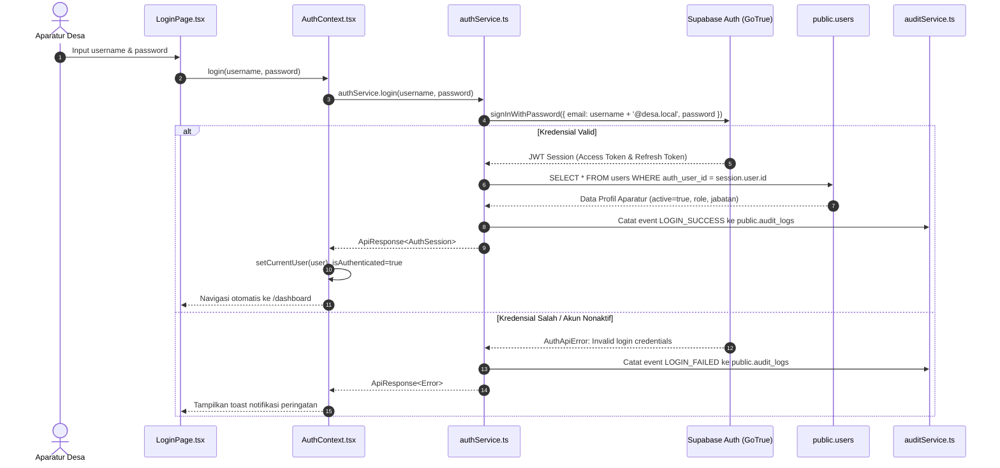
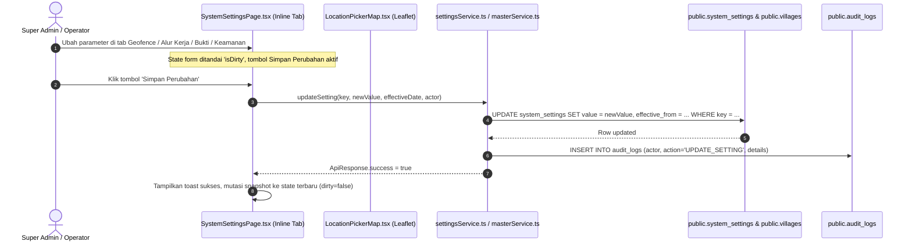
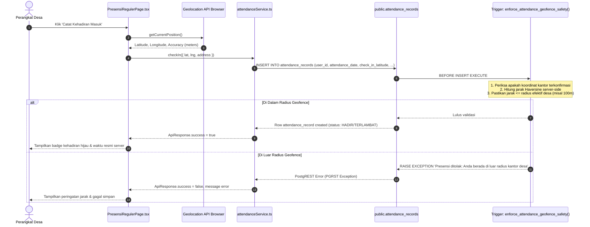
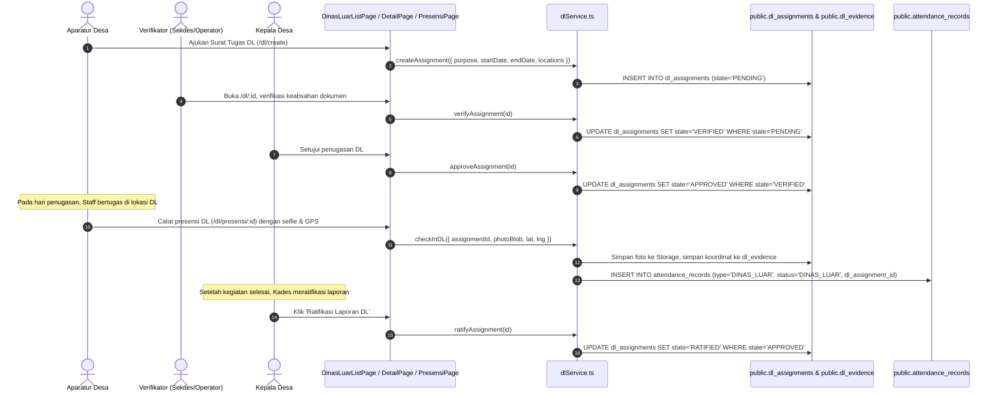

# PEMETAAN ALUR DATA LINTAS LAPISAN (FRONTEND TO BACKEND DATA FLOW)

**Tanggal:** 11 Oktober 2026  
**Metodologi:** Penelusuran Jalur Penuh (*Full-Path Tracing*):  
`Requirement → UI Component → State Management → Service Layer → PostgREST API / RPC → Database (Tables, Constraints, Triggers) → Authorization (RLS) → Response Handling → Automated Tests`

---

## 1. Domain A: Autentikasi dan Manajemen Sesi

- **Integritas Waktu Sesi:** Token sesi di-*refresh* otomatis oleh SDK `@supabase/supabase-js`. Durasi kedaluwarsa diselaraskan dengan parameter `SESSION_TIMEOUT_MINUTES` pada `system_settings`.
- **Proteksi Identitas:** Identitas aktor operasi sensitif diambil dari `auth.uid()` pada header JWT, bukan dari payload client.
- **Pembuktian Test:** `src/test/auth.test.ts`, `src/test/password_management.test.ts`.

---

## 2. Domain B & C: Pengaturan Sistem & Master Data Desa

- **Penyimpanan Selektif:** Hanya mengirim parameter yang terbukti berubah (*dirty checking*) terhadap snapshot backend.
- **Konsistensi Peta & Profil:** Pengubahan koordinat kantor pada tab Geofence menyinkronkan data ke `public.villages` (`latitude`, `longitude`, `alamat`) dan `public.system_settings` (`OFFICE_COORDINATES`).
- **Pembuktian Test:** `src/test/settings.test.ts`, `src/test/branding.test.ts`.

---

## 3. Domain D: Presensi Masuk (Check-In) dan Pulang (Check-Out) Kantor

- **Waktu Resmi Server:** Waktu pencatatan kehadiran menggunakan fungsi database `NOW()` / `CURRENT_DATE`, menolak manipulasi jam perangkat pengguna.
- **Pencegahan Duplikasi:** Constraint database `uq_user_attendance_date UNIQUE(user_id, attendance_date)` menolak transaksi presensi masuk ganda pada hari yang sama.
- **Pulang Cepat (ADR-010):** Jika presensi pulang dicatat sebelum jam kerja berakhir, sistem mencatat `is_early_leave=true`, `early_leave_reason`, dan `early_leave_minutes` tanpa mengubah status primer `HADIR`/`TERLAMBAT` menjadi `PULANG_CEPAT`.
- **Pembuktian Test:** `src/test/attendance.test.ts`.

---

## 4. Domain E: Penugasan dan Presensi Dinas Luar (DL)

- **Kewajiban Jam Kerja:** Selesainya kegiatan Dinas Luar tidak otomatis mengakhiri kewajiban kerja harian aparatur desa.
- **Integritas Bukti:** Presensi Dinas Luar mewajibkan swafoto (selfie) dan geotag koordinat GPS yang disimpan ke tabel `dl_evidence`.
- **Eksklusivitas Ratifikasi:** Trigger SQL memastikan hanya akun dengan role `KEPALA_DESA` yang memiliki hak meratifikasi surat tugas DL.
- **Pembuktian Test:** `src/test/dl.test.ts`.

---

## 5. Domain F: Alur Izin, Sakit, Cuti, dan Koreksi Presensi

1. **Izin & Sakit:** Diajukan oleh aparatur, dapat disetujui oleh Operator, Sekretaris Desa, atau Kepala Desa. Status langsung tercatat pada rekap kehadiran harian.
2. **Cuti Tahunan & Alasan Penting:** Diajukan oleh aparatur, diverifikasi oleh Sekretaris Desa atau Operator, dan **persetujuan akhir wajib dilakukan oleh Kepala Desa** (`KEPALA_DESA`).
3. **Koreksi Presensi (Attendance Correction):**
   - Diajukan melalui form koreksi non-destruktif dengan alasan logis.
   - Hanya dapat disetujui dan diterapkan oleh `OPERATOR_DESA`.
   - Data asli tersimpan pada kolom `original_check_in`, `original_check_out`, dan `original_status` di `attendance_records` untuk audit jejak.
- **Pembuktian Test:** `src/test/absence_correction.test.ts`.

---

## 6. Domain H, I, J: Pelaporan, Dashboard, dan Audit Trail

1. **Dashboard & Monitoring:** Mengambil agregasi langsung dari query Supabase (`status`, `attendance_date = CURRENT_DATE`), menampilkan kartu statistik real-time tanpa angka fiktif. Jika data belum tersedia, menampilkan *empty state*.
2. **Laporan & Ekspor:** Mengambil master data profil desa dan konfigurasi kop surat dinas yang aktif dari `system_settings`, menghasilkan rekap kehadiran PDF/Excel resmi.
3. **Audit Log:** Seluruh peristiwa autentikasi, modifikasi master data, pengaturan sistem, persetujuan cuti, dan koreksi presensi dicatat secara permanen pada tabel `public.audit_logs`. RLS melarang mutlak operasi `DELETE` dan `UPDATE` pada tabel ini.
- **Pembuktian Test:** `src/test/report_audit.test.ts`, `src/test/supabase_production_fallback.test.ts`.
