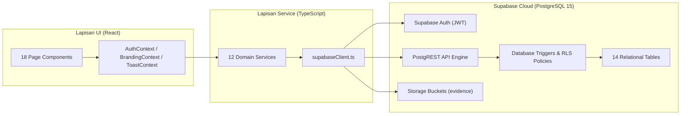

# INVENTARISASI MODUL DAN DEPENDENCY MAP KADESA

**Tanggal:** 11 Oktober 2026  
**Baseline Commit:** `993371aefd026edaaad2b714b7afab1be3d963e8` (`main`)  
**Status Audit:** EMPIRICALLY VERIFIED

---

## 1. Runtime, Framework, dan Dependency

### A. Core Stack
| Komponen | Spesifikasi / Versi | Peran dalam Sistem | Status Verifikasi |
|---|---|---|---|
| **Runtime** | Node.js v20+ / Browser ESM | Lingkungan eksekusi frontend & runner pengujian | VERIFIED (`package.json`) |
| **Framework UI** | React v19.0.0 | Rendering declarative UI dan state management | VERIFIED (`package.json`) |
| **DOM Renderer** | React-DOM v19.0.0 | Manipulasi DOM browser | VERIFIED (`package.json`) |
| **Routing** | React Router DOM v7.3.0 | Navigasi client-side SPA & route guards | VERIFIED (`package.json`) |
| **Bahasa** | TypeScript v5.8.2 | Type-safety statis, antarmuka, dan definisi model | VERIFIED (`tsconfig.json`) |
| **Build Tool** | Vite v6.2.1 | Hot Module Replacement (dev) & Rollup bundling (prod) | VERIFIED (`vite.config.ts`) |
| **Icon System** | Lucide React v1.16.0 | Ikonografi antarmuka pengguna | VERIFIED (`package.json`) |
| **Peta & GIS** | Leaflet v1.9.4 & `@types/leaflet` v1.9.22 | Peta interaktif, rendering lingkaran radius geofence | VERIFIED (`package.json`) |
| **Database SDK** | `@supabase/supabase-js` v2.117.3 | Klien resmi Supabase (Auth, PostgREST, Storage) | VERIFIED (`package.json`) |

### B. Development & Testing Stack
| Package | Versi | Peran |
|---|---|---|
| `vitest` | v3.0.8 | Test runner berkinerja tinggi untuk unit & integration test |
| `@testing-library/react` | v16.2.0 | Testing komponen React & interaksi DOM |
| `@testing-library/jest-dom` | v6.6.3 | Custom matchers untuk asersi DOM |
| `jsdom` | v26.0.0 | Emulasi lingkungan browser untuk pengujian Vitest |
| `eslint` & `typescript-eslint` | v10.12.0 / v8.71.1 | Linter kode statis dan standardisasi syntax |

---

## 2. Struktur Route, Layout, Halaman, dan Navigasi

Semua route didaftarkan pada [`src/App.tsx`](file:///d:/DAWANK/APLIKASI_TEST/KADESA/src/App.tsx):

```mermaid
graph TD
    Root["/"] --> AppShell["AppLayout (Shell Terproteksi)"]
    Root --> Login["/login (Publik)"]
    Root --> Forgot["/forgot-password (Publik)"]
    Root --> Reset["/reset-password (Publik)"]
    Root --> NotFound["* (404 Not Found)"]

    AppShell --> Dashboard["/dashboard (DashboardRouter)"]
    AppShell --> AttReg["/attendance/regular (PresensiRegulerPage)"]
    AppShell --> AttMon["/attendance/monitoring (MonitoringPresensiPage)"]
    AppShell --> DLList["/dl (DinasLuarListPage)"]
    AppShell --> DLCreate["/dl/create (DinasLuarCreatePage)"]
    AppShell --> DLDetail["/dl/:id (DinasLuarDetailPage)"]
    AppShell --> DLPresensi["/dl/presensi/:id (DinasLuarPresensiPage)"]
    AppShell --> IzinSakit["/absence/izin-sakit (IzinSakitPage)"]
    AppShell --> Cuti["/absence/cuti (CutiPage)"]
    AppShell --> MasterDesa["/master/desa (MasterDesaPage)"]
    AppShell --> MasterAparatur["/master/aparatur (MasterAparaturPage)"]
    AppShell --> MasterJabatan["/master/jabatan (MasterJabatanPage)"]
    AppShell --> Reports["/reports (ReportsPage)"]
    AppShell --> Settings["/settings (SystemSettingsPage)"]
    AppShell --> Audit["/audit (AuditLogPage)"]
    AppShell --> Profile["/profile (ProfilePage)"]
    AppShell --> Notif["/notifications (NotificationsPage)"]
    AppShell --> Forbidden["/forbidden (ForbiddenPage)"]
```

### Rincian Gating Route Berbasis Permission
| Path | Komponen Halaman | Izin Akses Diwajibkan (`requiredPermission`) |
|---|---|---|
| `/dashboard` | `DashboardRouter` | `view_dashboard` (semua role terautentikasi) |
| `/attendance/regular` | `PresensiRegulerPage` | `regular_attendance` (selain `SUPER_ADMIN`) |
| `/attendance/monitoring` | `MonitoringPresensiPage` | `monitor_attendance` (`SUPER_ADMIN`, `OPERATOR_DESA`, `KEPALA_DESA`, `SEKRETARIS_DESA`) |
| `/dl` | `DinasLuarListPage` | Terautentikasi (semua aparatur) |
| `/dl/create` | `DinasLuarCreatePage` | Terautentikasi (filter internal per-role) |
| `/dl/:id` | `DinasLuarDetailPage` | Terautentikasi |
| `/dl/presensi/:id` | `DinasLuarPresensiPage` | Terautentikasi (pemilik tugas) |
| `/absence/izin-sakit` | `IzinSakitPage` | Terautentikasi (semua aparatur) |
| `/absence/cuti` | `CutiPage` | Terautentikasi (semua aparatur) |
| `/master/desa` | `MasterDesaPage` | `view_master_desa` (selain `PERANGKAT_DESA`) |
| `/master/aparatur` | `MasterAparaturPage` | `view_master_aparatur` (selain `PERANGKAT_DESA`) |
| `/master/jabatan` | `MasterJabatanPage` | `view_master_jabatan` (selain `PERANGKAT_DESA`) |
| `/reports` | `ReportsPage` | `view_reports` (semua aparatur) |
| `/settings` | `SystemSettingsPage` | `manage_settings` (`SUPER_ADMIN`, `OPERATOR_DESA`) |
| `/audit` | `AuditLogPage` | `view_audit_logs` (`SUPER_ADMIN`, `OPERATOR_DESA`, `KEPALA_DESA`, `SEKRETARIS_DESA`) |
| `/profile` | `ProfilePage` | Terautentikasi |
| `/notifications` | `NotificationsPage` | Terautentikasi |

---

## 3. Inventarisasi Layanan Frontend (Service Layer)

Lokasi: [`src/services/`](file:///d:/DAWANK/APLIKASI_TEST/KADESA/src/services/)
Semua service mengembalikan kontrak terstandarisasi `Promise<ApiResponse<T>>`:

| Nama Service | Berkas | Deskripsi Fungsional | Endpoint / Tabel Terhubung |
|---|---|---|---|
| **apiClient** | `apiClient.ts` | Tipe generik `ApiResponse<T>`, konfigurasi mode demo (`IS_DEMO_MODE`), dan mock latency. | Konfigurasi internal |
| **supabaseClient** | `supabaseClient.ts` | Inisialisasi klien Supabase, validasi environment URL & Anon Key. | Supabase Client Instance |
| **authService** | `authService.ts` | Login email/username, manajemen sesi auth, profile fetch, reset password, permission matrix. | `auth.users`, `public.users` |
| **attendanceService**| `attendanceService.ts` | Presensi masuk & pulang, validasi jadwal harian, geofence check, early leave reason, audit. | `attendance_records`, `work_schedules`, `holidays`, RPC `rpc_check_in_with_geofence` |
| **dlService** | `dlService.ts` | State machine Dinas Luar (`PENDING` $\rightarrow$ `VERIFIED` $\rightarrow$ `APPROVED` $\rightarrow$ `RATIFIED`), verifikasi atasan, presensi DL, upload bukti. | `dl_assignments`, `dl_locations`, `dl_evidence`, `attendance_records` |
| **absenceService** | `absenceService.ts` | Pengajuan Izin/Sakit/Cuti, verifikasi Sekdes/Operator, persetujuan Kepala Desa, rekap jatah cuti. | `absence_requests`, `attendance_records` |
| **correctionService**| `correctionService.ts` | Pengajuan koreksi absensi, persetujuan Operator, pembukuan perubahan status non-destruktif. | `attendance_corrections`, `attendance_records`, RPC `apply_attendance_correction` |
| **masterService** | `masterService.ts` | Manajemen profil desa, daftar aparatur, penetapan role Operator, master jabatan organisasi. | `villages`, `users`, `positions` |
| **settingsService** | `settingsService.ts` | Konfigurasi sistem dinamis (Geofence, Alur Kerja, Bukti Selfie, Keamanan, Zona Waktu, Kalender). | `system_settings`, `work_schedules`, `holidays` |
| **reportService** | `reportService.ts` | Rekapitulasi presensi harian/bulanan, ekspor PDF/Excel, penerapan kop surat dinas. | `attendance_records`, `users`, `villages` |
| **auditService** | `auditService.ts` | Query log audit tindakan penting, pencatatan security event, proteksi immutability. | `audit_logs` |
| **notificationService**| `notificationService.ts`| Pengambilan notifikasi in-app, penandaan baca, badge unread counter. | `notifications` |

---

## 4. Inventarisasi Skema Database (Supabase PostgreSQL)

### A. Tipe ENUM Kustom
1. `user_role_enum`: `'SUPER_ADMIN'`, `'OPERATOR_DESA'`, `'KEPALA_DESA'`, `'SEKRETARIS_DESA'`, `'PERANGKAT_DESA'`
2. `setting_category_enum`: `'WORK_SCHEDULE'`, `'GEOFENCE'`, `'WORKFLOW'`, `'EVIDENCE'`, `'SECURITY'`, `'BRANDING'`, `'LETTERHEAD'`
3. `attendance_type_enum`: `'REGULAR'`, `'DINAS_LUAR'`
4. `attendance_status_enum`: `'HADIR'`, `'TERLAMBAT'`, `'ALPHA'`, `'IZIN'`, `'SAKIT'`, `'DINAS_LUAR'`, `'CUTI'`, `'LIBUR'`
5. `dl_state_enum`: `'PENDING'`, `'VERIFIED'`, `'APPROVED'`, `'RATIFIED'`, `'REJECTED'`, `'CANCELLED'`, `'RATIFICATION_OVERDUE'`
6. `absence_type_enum`: `'IZIN'`, `'SAKIT'`, `'CUTI_TAHUNAN'`, `'CUTI_MELAHIRKAN'`, `'CUTI_ALASAN_PENTING'`, `'CUTI_BESAR'`
7. `absence_state_enum`: `'SUBMITTED'`, `'VERIFIED'`, `'APPROVED'`, `'REJECTED'`
8. `correction_state_enum`: `'ORIGINAL'`, `'PENDING_CORRECTION'`, `'CORRECTED'`

### B. 14 Tabel Relasional Inti
| No | Nama Tabel | Primary Key | Keterangan & Relasi Utama |
|---|---|---|---|
| 1 | `villages` | `id VARCHAR(50)` | Master profil desa & titik pusat geofence resmi (`latitude`, `longitude`, `radius_meters`). |
| 2 | `positions` | `id VARCHAR(50)` | Master jabatan aparatur desa (misal: Kepala Desa, Kaur Keuangan, Kadus). |
| 3 | `users` | `id VARCHAR(50)` | Akun pengguna (`auth_user_id` $\rightarrow$ `auth.users`, `jabatan_id` $\rightarrow$ `positions`, `role`). |
| 4 | `system_settings` | `id VARCHAR(50)` | Konfigurasi sistem berbasis tanggal efektif (`key`, `value`, `effective_from`). |
| 5 | `work_schedules` | `id VARCHAR(50)` | Jadwal operasional hari kerja mingguan (`day_of_week` 1-7, `start_time`, `end_time`, `tolerance_minutes`). |
| 6 | `holidays` | `id VARCHAR(50)` | Kalender libur nasional & khusus desa (`date`, `name`, `active`). |
| 7 | `attendance_records`| `id VARCHAR(50)` | Transaksi presensi harian (`user_id` + `attendance_date` UNIQUE, GPS check-in/out, status). |
| 8 | `dl_assignments` | `id VARCHAR(50)` | Surat tugas penugasan Dinas Luar (`subject_user_id`, `state`, deadline ratifikasi). |
| 9 | `dl_locations` | `id VARCHAR(50)` | Titik koordinat lokasi tujuan penugasan DL (`dl_assignment_id` CASCADE). |
| 10| `dl_evidence` | `id VARCHAR(50)` | Berkas foto selfie bukti kehadiran DL (`storage_reference`, GPS, timestamp). |
| 11| `absence_requests` | `id VARCHAR(50)` | Pengajuan Izin/Sakit/Cuti aparatur (`user_id`, `type`, `start_date`, `end_date`, `state`). |
| 12| `attendance_corrections` | `id VARCHAR(50)` | Permohonan koreksi presensi non-destruktif (`attendance_record_id`, `original_*`, `corrected_*`). |
| 13| `audit_logs` | `id VARCHAR(50)` | Log audit tindakan keamanan & administrasi desa (Immutable append-only). |
| 14| `notifications` | `id VARCHAR(50)` | Notifikasi in-app untuk pengguna sistem desa (`recipient_user_id`, `read`). |

### C. Stored Functions, RPC, dan Trigger Utama
1. `calculate_haversine_distance_meters(lat1, lon1, lat2, lon2)`:
   - Kalkulasi matematis jarak permukaan bumi lingkaran besar dalam meter (fungsi IMMUTABLE STRICT SECURITY DEFINER).
2. `enforce_attendance_geofence_safety()`:
   - Trigger `BEFORE INSERT OR UPDATE ON attendance_records`.
   - Menolak transaksi jika koordinat belum dikonfirmasi, di luar radius, koordinat parsial, atau manipulasi GPS historis.
3. `enforce_approval_workflow_integrity()`:
   - Trigger `BEFORE UPDATE ON absence_requests`, `attendance_corrections`, `dl_assignments`.
   - Menjamin bahwa approval hanya dapat dilakukan oleh role berwenang dan mencegah self-approval / bypass status.
4. `rpc_check_in_with_geofence` & `rpc_check_out_with_geofence`:
   - Remote Procedure Call transaksi presensi atomik.
5. `apply_attendance_correction`:
   - RPC atomik untuk menyetujui dan menerapkan koreksi presensi ke `attendance_records` dalam 1 transaksi database.

---

## 5. Storage Buckets & Manajemen Berkas

| Bucket ID | Public/Private | Konten | Kebijakan Akses |
|---|---|---|---|
| `evidence` | Private | Foto selfie presensi DL & lampiran surat sakit/izin | RLS Storage: Upload oleh pemilik akun terautentikasi; Baca oleh pemilik dan atasan penilai (`SUPER_ADMIN`, `OPERATOR_DESA`, `KEPALA_DESA`, `SEKRETARIS_DESA`). |
| `branding` | Public / Read-Only | Logo resmi desa & foto latar belakang login | Baca publik anonim; Tulis khusus `SUPER_ADMIN` dan `OPERATOR_DESA`. |

---

## 6. Dependency Map Arsitektur

---

## 7. Status Pembersihan Mock & Fallback

Berdasarkan audit eliminasi mock sebelumnya:
- **Mode Demo Frontend (`VITE_ENABLE_DEMO_MODE=false`):** Seluruh service beroperasi secara eksklusif menggunakan Supabase API. Tidak ada fallback lokal tersembunyi ke `mockData.ts` saat error backend terjadi.
- **Error Handling:** Jika database merespons error (misal tabel kosong, RLS menolak, atau network timeout), sistem melaporkan error asli atau koleksi kosong `[]` secara transparan.
